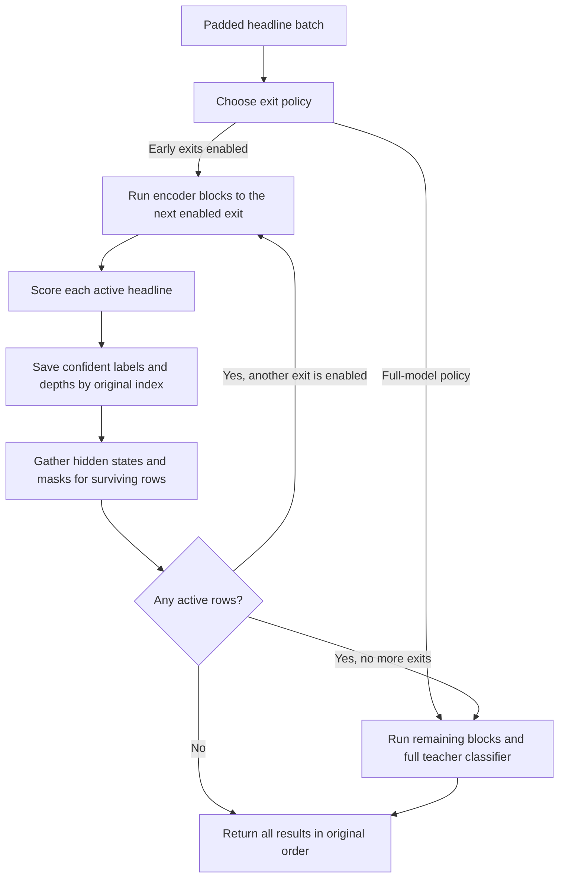

# Batch-aware early exit for FinBERT

Can a policy tuned to the input batch size reduce end-to-end latency while keeping test macro-F1 within one percentage point of full FinBERT?

## Routing



Reuse the frozen teacher, calibrated heads at layers 2, 4, and 8, and saved data splits. Keep the existing single-headline runner as the reference.

The batched route lives in `run_batch_exits.py`. Start with padded token inputs and track original row indices. At each enabled head, save labels and depths for rows that meet the confidence threshold. Gather the surviving hidden states, attention masks, and row indices before running more blocks. Return when every row has exited. Use the teacher classifier for the final survivors and return results in input order.

Use the same batched implementation, scoring rule, and trained weights for all early-exit policies. The fixed baseline uses one confidence threshold and exit set across batch sizes. The shared schedule can use different thresholds at each exit depth but applies the same schedule at every batch size. The adaptive policy selects a separate schedule for each batch size.

Check batch-size-one parity and compare batched labels and depths with the scalar route using equivalent padded inputs. Cover mixed exit depths, all rows exiting early, and all rows reaching the teacher head. Inspect near-threshold numerical differences and verify that later blocks receive only surviving rows.

## Policy selection

Reuse the temperatures fitted on calibration data by the multi-exit run. On validation, evaluate a small grid of exit sets and max-probability schedules using real batched inference. Time candidates within the existing 0.75 percentage point macro-F1 margin. Choose the fixed threshold and shared schedule by mean relative median latency across batch sizes, requiring them to meet the quality margin at every size. Choose the adaptive policy by measured median latency at each batch size. Both the shared and adaptive searches consider full inference as a fallback. Record the policy choices before evaluating test data.

## GPU benchmark

Add a separate runner for batch sizes 1, 4, 16, and 32 on the same A100. Compare full FinBERT, fixed-threshold batched early exit, the shared schedule, the adaptive policy, and the original max-probability policy. Load that reference from the scalar run’s validation selection (layer 8 at 0.76 for job 29383). Benchmark it at every size and include it in the validation candidate grid. A matched compact-student benchmark can be added separately. Use identical batches across routes, warm up every route, randomize timing order, and synchronize CUDA around each timed call.

Measure median and p95 end-to-end batch completion time, headlines per second, test macro-F1 drop, mean layers, and exit fractions. Include tokenization, padding, transfer, routing and compaction, and delivery of predictions to the CPU in the timed region. Batch completion starts with a formed batch and excludes request queueing.

Report which batch sizes, if any, favor adaptation over the shared schedule and full FinBERT within the one-point test F1 budget. Use active batch sizes and routing overhead to explain cases where fewer executed layers fail to improve latency.

## Running on Cloud Bursting

Use the same `assets/` directory as the completed multi-exit run. Pass that run's output directory, which contains `config.json`, `exit_heads.pt`, `temperatures.json`, and `selected_policies.json`.

```bash
mkdir -p logs
sbatch --account=csci_ga_3033-2026fa --partition=c12m85-a100-1 \
  hpc/batch_exits.sbatch results/exits-default-MULTI_EXIT_JOB_ID
```

The batch job writes to `results/batch-exits-JOB_ID/`. Start with `selected_policies.json` and `metrics.csv`. An empty shared or adaptive schedule means validation selected the full model. A null fixed policy means no shared threshold met the validation quality limit at every batch size. Quality uses all headlines. Timing uses complete batches and checks every timed label and exit depth against the corresponding untimed run.
