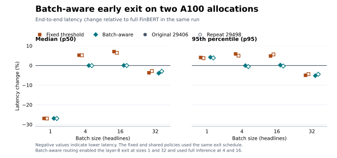

# FinBERT batch-aware early exit results

Both runs used one NVIDIA A100 40 GB per allocation. Job 29498 replayed the schedules from job 29406 with the same teacher, exit heads, calibration temperatures, and test set.

## Test quality and throughput

| Batch size | Policy | Macro-F1 drop (pp) | 29406 headlines/s | 29498 headlines/s |
|---:|---|---:|---:|---:|
| 1 | Full FinBERT | 0.000 | 119.4 | 110.6 |
| 1 | Fixed | 0.798 | 141.3 | 131.1 |
| 1 | Shared | 0.798 | 141.3 | 131.1 |
| 1 | Batch-aware | 0.798 | 141.2 | 131.2 |
| 4 | Full FinBERT | 0.000 | 440.1 | 410.3 |
| 4 | Fixed | 0.798 | 435.8 | 407.2 |
| 4 | Shared | 0.798 | 436.0 | 407.9 |
| 4 | Batch-aware | 0.000 | 440.2 | 411.2 |
| 16 | Full FinBERT | 0.000 | 1,678.9 | 1,565.1 |
| 16 | Fixed | 0.798 | 1,574.2 | 1,473.0 |
| 16 | Shared | 0.798 | 1,577.7 | 1,473.9 |
| 16 | Batch-aware | 0.000 | 1,681.1 | 1,567.7 |
| 32 | Full FinBERT | 0.000 | 2,192.9 | 2,169.3 |
| 32 | Fixed | 0.798 | 2,301.7 | 2,242.1 |
| 32 | Shared | 0.798 | 2,301.9 | 2,247.2 |
| 32 | Batch-aware | 0.798 | 2,302.5 | 2,248.0 |

F1 drops are relative to the full teacher within each job. Test quality covers 1,573 headlines. Timing starts with a formed batch and includes tokenization, padding, transfer, routing, and prediction return.

## End-to-end latency

Percent change in median and p95 end-to-end batch latency relative to full FinBERT measured within each run. Filled markers show job 29406 and open markers show job 29498. The fixed policy represents the schedule also used by the shared policy. Batch-aware routing enables the layer-8 exit at sizes 1 and 32 and uses the full model at sizes 4 and 16. Median reductions were 26.9–27.0% at size 1 and 2.9–4.0% at size 32. At size 1 the p95 increased in both runs. At size 32 both the median and p95 decreased.

## Separate B200 student comparison

In the NYU Torch B200 experiment, the freshly trained compact student reduced median latency from 2.559 to 1.885 ms (26.3%). Test macro-F1 was 0.879177 for the student and 0.878955 for the full model. That comparison used different hardware and teacher weights from the A100 runs.

## Replay assets and raw results

The four archives are listed below with SHA-256 checksums from the verified local copies. Team members can use these checksums after downloading the files. [FinBERT A100 experiment backups](https://drive.google.com/drive/folders/1VuMZ91NpdgtgvSS9TH6WBflB7dROEaLf?usp=drive_link)

| Archive | Contents | SHA-256 |
|---|---|---|
| `finbert-a100-teacher-and-splits.tar.gz` | Teacher checkpoint, tokenizer, dataset splits, and asset manifest | `7a46a6bf913cd1866dab79c7c626d7b3c0ba5c3c0b15f1ca283093057e2d16bb` |
| `exits-29383-replay-inputs.tar.gz` | Exit heads, calibration temperatures, configuration, selected policies, and matching asset manifest | `dbd4188edb801e4becf7a11345b2a78b07d85762df7e87146a6fe1e8ec942290` |
| `batch-exits-29406-raw.tar.gz` | Original run's test timings, validation timings, and predictions | `f47f24a3b408bf7d4319eb088fecddca6ea4252ecabdca1b8dc89a3bc8860954` |
| `batch-exits-29498-raw.tar.gz` | Frozen-policy repeat's test timings and predictions | `0f9d00731d03095e759f803000a1b6b48624826d00be718cfcbfe34577c6dc0a` |

For replay, unpack the first two archives from the repository root. They restore `assets/` and `results/exits-default-29383/`. The frozen schedules for the repeat are in `reports/nyu_hpc/batch-exits-29406/selected_policies.json`.

## Sources

- [Job 29406 metrics](https://github.com/shakeelriyaj/efficientAI/blob/f07d85bde533d2cf715379797b0177b12faafad9/reports/nyu_hpc/batch-exits-29406/metrics.csv)
- [Job 29498 metrics](https://github.com/shakeelriyaj/efficientAI/blob/82c4488e7c69ff2bf265247ddaaaf0f11069a580/reports/nyu_hpc/batch-exits-29498/metrics.csv)
- [B200 reproduction report](https://github.com/shakeelriyaj/efficientAI/blob/f07d85bde533d2cf715379797b0177b12faafad9/reports/HPC_Reproduction_Report.txt)
